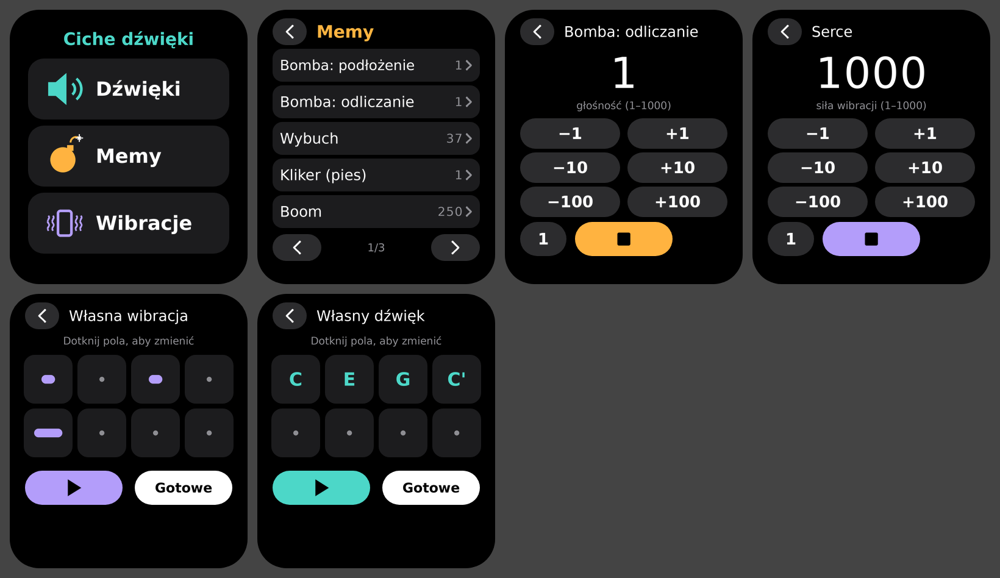

# Dźwięki na Redmi Watch 4

Szybka aplikacja (quick app, plik `.rpk`) dla zegarka **Redmi Watch 4** z HyperOS (Xiaomi Vela). Odtwarza własne dźwięki, memowe efekty i wibracje. Każdy ma osobny poziom od **1 do 1000**.



**Gotowa paczka:** [`Dzwieki.rpk`](Dzwieki.rpk)

## Jak działa poziom 1–1000
- **Wszystko startuje na poziomie 1, czyli super cicho.** Dotyczy każdego dźwięku i każdej wibracji, także nowo dodanych.
- Zmieniony poziom zapisuje się od razu w pamięci zegarka, osobno dla każdego elementu, i zostaje po zamknięciu aplikacji.
- Przyciski `−1 +1 −10 +10 −100 +100` zmieniają poziom. Przycisk `1` od razu wraca do najcichszego.
- Na liście przy każdej nazwie widać jej zapisany poziom.

**Dźwięk:** poziom 1 to 0,1% pełnej głośności (−60 dB, ledwo słyszalny szept), a 1000 to pełna głośność. Skala jest logarytmiczna, więc każdy krok w górę słychać podobnie na całej skali. Każdy dźwięk jest w paczce w trzech wersjach: pełnej, −20 dB i −40 dB. Aplikacja bierze najcichszą wersję, która wystarcza, a resztę reguluje głośnością odtwarzacza. Dzięki temu poziom 1 jest bardzo cichy nawet wtedy, gdy zegarek zaokrągla głośność.

**Wibracja:** Redmi Watch 4 udostępnia aplikacjom tylko krótki i długi impuls, a siły silnika nie da się zmienić. Poziom 1 to jeden najkrótszy impuls, czyli najsłabsza wibracja, jaką zegarek potrafi zrobić. Wyższe poziomy wydłużają każde uderzenie, aż do około 0,4 s brzęczenia. Odczuwalnych stopni jest więc około 10, nie 1000. Sąsiednie poziomy czuć tak samo.

## Co jest w środku
Menu ma trzy kafelki: **Dźwięki**, **Memy** i **Wibracje**.

| Dźwięki | Memy | Wibracje |
|---|---|---|
| Ping, Kropla, Dzwonek, Ptaszek, Gong, Klik, Alarm, Fanfara | Bomba: podłożenie, Bomba: odliczanie, Wybuch, Kliker (pies), Boom, Smutna trąbka, Ba dum tss, Trąbka MLG, Metalowa rura, Świerszcze, Boing, Błąd, Pierd | Tik, Podwójny, Serce, Fala, SOS, Alarm, Zegar |
| **Własny dźwięk**: melodia z 8 pól (nuty C D E F G A H C′ albo pauza) | | **Własna wibracja**: 8 pól (pauza, krótki tik albo długie BZZ) |

Memy:
- **Bomba: podłożenie**: wpisywanie kodu (7 piknięć) i uzbrojenie.
- **Bomba: odliczanie**: pikanie coraz szybciej, długi pisk i wybuch (ok. 6 s).
- **Kliker (pies)**: „klik-klak” jak kliker do szkolenia psa.

**Wszystkie dźwięki są oryginalne**, syntezowane od zera skryptem `scripts/gen_sounds.py`. Memy tylko naśladują znany klimat, np. bomby z gier FPS. W paczce nie ma nagrań z CS:GO ani innych gier i filmów, bo są chronione prawem autorskim.

**Edytor własnych:** w ekranie poziomu „Własny dźwięk” lub „Własna wibracja” naciśnij ✎. Dotknięcie pola przełącza je na następną wartość i od razu je odtwarza. Kroki zapisują się same. `▶` gra całość, `■` zatrzymuje.

## Uwaga: dźwięk nie jest jeszcze sprawdzony na zegarku
Odtwarzanie dźwięku (`system.audio`) jest w oficjalnej dokumentacji Vela, ale Xiaomi nie podaje, czy działa na Redmi Watch 4. Na tym zegarku nikt tego jeszcze nie sprawdził. Wibracja (`vibrator.vibrate`) działa, bo została potwierdzona w innej aplikacji.
- Jeśli zegarek nie odtworzy pliku `.mp3`, aplikacja sama przełączy się na zapasowe pliki `.wav` i to zapamięta. Plik `.wav` jest tylko w pełnej głośności, więc wtedy całą głośność ustawia odtwarzacz.
- Jeśli żaden format nie zagra, pod przyciskami pojawi się napis **„Zegarek nie odtworzył dźwięku”**. Wibracje działają wtedy dalej.
- Aplikacja nie rysuje nic na `canvas` (to restartowało zegarek) i działa tylko, gdy ją otworzysz. Nie ma więc ryzyka restartu w kółko, jak przy tarczy.

## Instalacja (Notify for Xiaomi)
Potrzebny jest **telefon z Androidem**.

1. Pobierz `Dzwieki.rpk` na telefon.
2. W **Notify for Xiaomi** wejdź w **Device → Third party app** i wybierz `Dzwieki.rpk`. (Mi Fitness musi być zatrzymany, zegarka nie rozparowuj).
3. Aplikacja „Dźwięki” pojawi się na liście aplikacji na zegarku.

**Aktualizacja:** najpierw usuń starą wersję z zegarka, potem wgraj nową. Notify nie nadpisuje zainstalowanej aplikacji.

## Budowanie
Wymagany Node.js 18+. Do generowania grafik i dźwięków potrzebny jest Python 3 z Pillow i numpy oraz ffmpeg.

```
npm install
npm test                         # testy poziomów i logiki ekranu
python3 scripts/gen_assets.py    # grafiki (tylko gdy zmieniasz wygląd)
python3 scripts/gen_sounds.py    # dźwięki (tylko gdy je zmieniasz)
npm run build                    # paczka trafia do dist/
cp dist/*.rpk Dzwieki.rpk
node scripts/preview.mjs podglad.png   # podgląd ekranów w Chromium (Playwright)
```

Przy każdej nowej wersji zwiększ `versionName` i `versionCode` w `src/manifest.json`.

## Pliki
| Plik | Opis |
|---|---|
| `Dzwieki.rpk` | gotowa paczka do instalacji |
| `src/manifest.json` | nazwa, pakiet `com.xt.dzwieki`, wersja, uprawnienia (wibracja, audio, pamięć) |
| `src/pages/index/index.ux` | ekrany (menu, lista, poziom, edytor) i odtwarzanie |
| `src/common/levels.js` | poziomy 1–1000, przeliczenie na głośność i impulsy wibracji |
| `src/common/catalog.js` | lista dźwięków, memów i wzorów wibracji |
| `src/common/durations.js` | długości dźwięków (generowane przez `gen_sounds.py`) |
| `src/common/img/`, `src/common/snd/` | grafiki (napisy jako PNG) i dźwięki |
| `scripts/` | generatory grafik i dźwięków, podgląd ekranów |
| `test/` | testy (`npm test`) |
