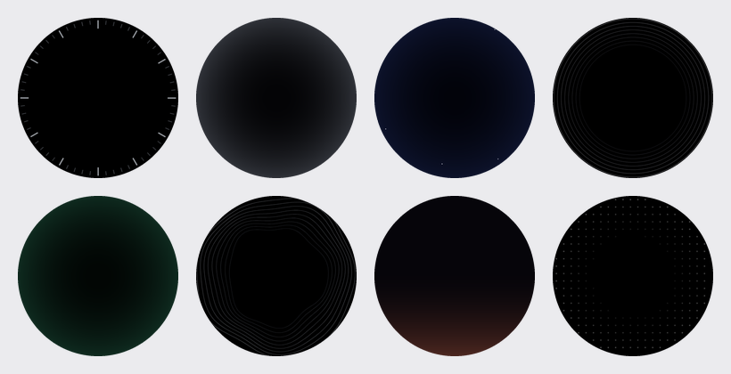

# Tła do zegarka Maxcom FW58 Vanad Pro

Osiem minimalistycznych teł **390×390** do funkcji **Własna tarcza** w aplikacji FitCloudPro. Środek każdego tła jest ciemny i spokojny, bo zegarek rysuje tam godzinę. Ciemne tła oszczędzają też baterię na ekranie AMOLED.



| Plik | Styl |
|---|---|
| [`01-grafit-kreski.png`](tla/01-grafit-kreski.png) | czerń z kreskami minut na krawędzi |
| [`02-grafitowa-mgla.png`](tla/02-grafitowa-mgla.png) | grafitowy gradient |
| [`03-granatowa-noc.png`](tla/03-granatowa-noc.png) | granat z gwiazdami przy krawędzi |
| [`04-okregi.png`](tla/04-okregi.png) | cienkie okręgi |
| [`05-ciemny-las.png`](tla/05-ciemny-las.png) | głęboka zieleń |
| [`06-poziomice.png`](tla/06-poziomice.png) | linie jak na mapie poziomicowej |
| [`07-swit.png`](tla/07-swit.png) | ciepły, przygaszony świt od dołu |
| [`08-kropki.png`](tla/08-kropki.png) | siatka kropek |

## Jak ustawić tło (krok po kroku)
1. **Zapisz tło na telefonie.** Pobierz wybrany plik PNG i upewnij się, że widać go w Galerii lub Zdjęciach.
2. **Otwórz FitCloudPro** i sprawdź, czy zegarek jest połączony (na górze ekranu urządzenia).
3. Wejdź w **Urządzenie → Ustawienia tarczy** (Watch Face Settings).
4. Stuknij **Własna tarcza** (Custom Watch Face). To pierwsza pozycja w lewym górnym rogu, z ikoną ołówka.
5. Wybierz **Tło**, a potem **Album** lub **Galeria**, i wskaż pobrany plik. Jeśli aplikacja pokaże kadrowanie, zaznacz cały obraz. Tło jest już kwadratowe 390×390, więc nic nie trzeba przycinać.
6. Ustaw **położenie godziny** (np. na środku) i **styl lub kolor**. Na tych tłach najlepiej wygląda **biały** lub **jasnoszary** tekst.
7. Stuknij **Ustaw jako tarczę** (Set as Watch Face).
8. Poczekaj, aż tarcza się wygeneruje i wyśle. Trzymaj telefon blisko zegarka i nie zamykaj aplikacji. Zegarek sam przełączy się na nową tarczę.

### Gdy coś nie działa
- **Brak opcji „Własna tarcza”:** zaktualizuj FitCloudPro i sprawdź, czy zegarek jest połączony.
- **Wysyłanie stoi w miejscu:** wyłącz i włącz Bluetooth, zbliż telefon do zegarka i spróbuj ponownie.
- **Godzina słabo widoczna:** zmień kolor tekstu na biały albo wybierz tło z ciemniejszym środkiem (np. 01, 04, 08).

To oficjalna funkcja aplikacji producenta, więc nic nie ryzykujesz.

## Własne warianty
Tła generuje skrypt (Python 3 + Pillow):

```
python3 scripts/gen_tla.py
```

Kolory i wzory zmienisz w funkcjach w `scripts/gen_tla.py`.
