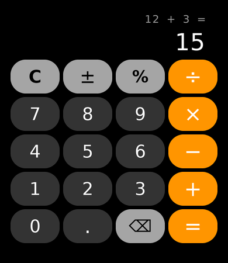

# Kalkulator na Redmi Watch 4

Prosty kalkulator jako „szybka aplikacja” (quick app, plik `.rpk`) dla zegarka **Redmi Watch 4** z HyperOS (Xiaomi Vela).



**Gotowa paczka:** [`Kalkulator.rpk`](Kalkulator.rpk)

## Funkcje
- Dodawanie, odejmowanie, mnożenie, dzielenie (`÷ × − +`).
- `C` czyści wszystko, `⌫` kasuje ostatnią cyfrę, `±` zmienia znak.
- `%`: samodzielnie dzieli przez 100. Po `+` lub `−` liczy procent pierwszej liczby, np. `200 + 10 %` daje `20`, a `=` daje `220`.
- Ponowne `=` powtarza ostatnie działanie (`2 + 3 = =` daje `8`).
- Górna szara linia pokazuje bieżące działanie, np. `12 + 3 =`.
- Dzielenie przez zero wyświetla `Error`, a następny klawisz zaczyna od nowa.
- Wynik ma do 12 znaków. Większe i bardzo małe liczby są w zapisie wykładniczym, np. `1e13`.
- Krótka wibracja przy każdym naciśnięciu.

## Instalacja (Notify for Xiaomi)
Potrzebny jest **telefon z Androidem**, bo z iPhone'a nie da się wgrać pliku `.rpk`.

1. Pobierz `Kalkulator.rpk` na telefon.
2. Zainstaluj **Notify for Xiaomi** ze Sklepu Play i przejdź kreator. Zaloguje się na Twoje konto Xiaomi i pobierze klucz zegarka.
3. Wymuś zatrzymanie **Mi Fitness** w ustawieniach aplikacji. Tylko jedna aplikacja może być połączona z zegarkiem. **Nie rozparowuj zegarka.**
4. W Notify wejdź w **Device → Third party app**, wybierz `Kalkulator.rpk` i postępuj zgodnie z instrukcjami.
5. Aplikacja „Kalkulator” pojawi się na liście aplikacji na zegarku.

Ograniczenia zegarka: najwyżej około 20 szybkich aplikacji i około 87 MB wolnego miejsca potrzebnego do instalacji.

## Budowanie
Wymagany Node.js 18+ (Python 3 z Pillow tylko do generowania grafik).

```
npm install
npm test                  # testy logiki kalkulatora
python3 scripts/gen_assets.py   # tylko gdy zmieniasz wygląd
npm run build             # paczka trafia do dist/
cp dist/*.rpk Kalkulator.rpk
```

Przy każdej nowej wersji zwiększ `versionName` i `versionCode` w `src/manifest.json`. Inaczej zegarek może zostawić starą wersję.

## Jak to działa
- Redmi Watch 4 nie rysuje tekstu w szybkich aplikacjach (`<text>` jest pusty), więc przyciski i cyfry na wyświetlaczu to gotowe obrazki PNG z `scripts/gen_assets.py`.
- Logika jest w `src/common/calc.js` (czysty JS, testy w `test/`), a ekran w `src/pages/index/index.ux`.
- Paczka jest podpisana kluczem debug z `aiot-toolkit`, co wystarcza do instalacji przez Notify.

## Pliki
| Plik | Opis |
|---|---|
| `Kalkulator.rpk` | gotowa paczka do instalacji |
| `src/manifest.json` | nazwa, pakiet `com.xt.rw4kalkulator`, wersja |
| `src/pages/index/index.ux` | ekran i obsługa dotyku |
| `src/common/calc.js` | logika kalkulatora |
| `src/common/img/` | grafiki przycisków i znaków |
| `scripts/gen_assets.py` | generator grafik |
| `test/calc.test.mjs` | testy |
