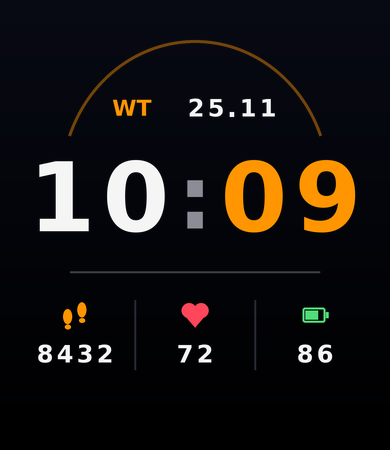
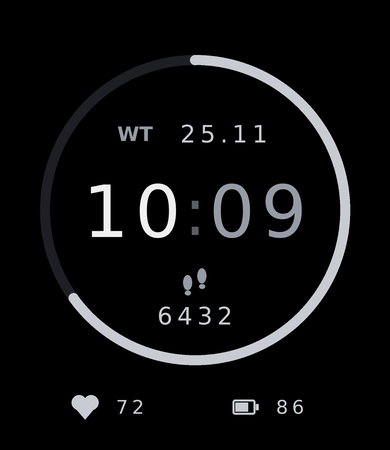
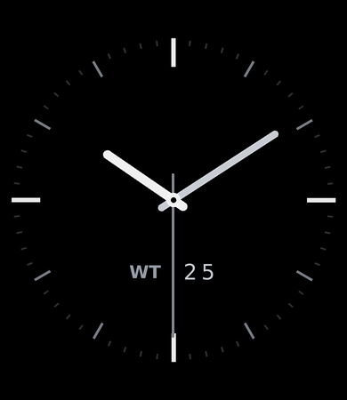

# Tarcze na Redmi Watch 4

Własne, minimalistyczne tarcze `.bin` dla zegarka **Redmi Watch 4** (390×450): biel i szarości na czarnym tle. Grafika jest oryginalna, rysowana skryptami.

| Tarcza | Plik | Co pokazuje |
|---|---|---|
| **Nocna** | [`Nocna.bin`](Nocna.bin) | duża godzina 24h, dzień tygodnia po polsku, data, kroki, tętno, bateria |
| **Pierścień** | [`Pierscien.bin`](Pierscien.bin) | godzina w środku pierścienia, który zapełnia się wraz z % dziennego celu kroków; data, kroki, tętno, bateria |
| **Analog** | [`Analog.bin`](Analog.bin) | wskazówki godzin, minut i sekund, kreski minut, dzień tygodnia i dzień miesiąca |

| Nocna | Pierścień | Analog |
|---|---|---|
|  |  |  |

> **Uwaga (nietestowane, możliwy restart w kółko):** po wgraniu tarczy **Pierścień** lub **Analog** zegarek użytkownika zaczął się restartować w kółko (logo Xiaomi, logo HyperOS, czarny ekran). Przyczyna nie jest jeszcze ustalona. **Nie wgrywaj tych dwóch tarcz**, dopóki nie zostanie to wyjaśnione. Działanie „Nocnej” zostało potwierdzone.

## Instalacja
W Notify for Xiaomi wybierz **Device → Watchface** i plik `.bin`. **Nie** używaj „Aktualizacji oprogramowania”, ta opcja służy do firmware'u.

## Budowanie
Wymaga Python 3 z Pillow i Node.js. Do pakowania `.bin` używany jest otwarty packer z projektu [Watchface Designer](https://github.com/calinhoria/watchface-designer) (czysty JS, bez dodatkowych pakietów).

```
git clone https://github.com/calinhoria/watchface-designer ../../watchface-designer
python3 scripts/gen_face.py      # Nocna -> build/face.json
python3 scripts/gen_extra.py     # Pierścień i Analog -> build/pierscien.json, build/analog.json
node scripts/build.mjs ../../watchface-designer Nocna.bin
node scripts/build.mjs ../../watchface-designer Pierscien.bin build/pierscien.json
node scripts/build.mjs ../../watchface-designer Analog.bin build/analog.json
```

`build.mjs` po spakowaniu rozpakowuje wynik i sprawdza typ zegarka, tytuł oraz liczbę elementów.

Numery tarcz (`1672100xx`) mają ten sam format co tarcze z oficjalnego kompilatora Mi Create. Przy numerze w innym formacie Notify ostrzegał o niezgodności modelu. Każda tarcza ma własny numer: Nocna 088, Pierścień 089, Analog 090.
