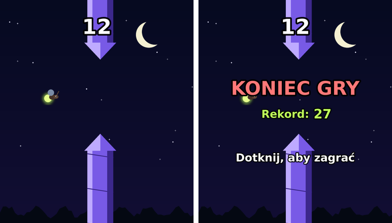

# Świetlik: gra na Redmi Watch 4

Oryginalna gra zręcznościowa jako „szybka aplikacja” (`.rpk`) dla zegarka **Redmi Watch 4** z HyperOS (Xiaomi Vela). Świetlik leci nocą między kryształowymi kolumnami. Każde dotknięcie ekranu podrywa go w górę, a zadaniem jest przelecieć przez jak najwięcej szczelin.



**Gotowa paczka:** [`Swietlik.rpk`](Swietlik.rpk)

## Jak grać
- Dotknij ekranu, żeby wystartować, i dotykaj dalej, żeby utrzymać świetlika w powietrzu.
- Każda minięta para kryształów daje punkt i krótką wibrację.
- Zderzenie z kryształem albo ziemią kończy grę długą wibracją.
- Rekord zapisuje się w pamięci zegarka.
- Po końcu gry dotknij ekranu, żeby zagrać ponownie.

## Instalacja (Notify for Xiaomi)
Potrzebny jest telefon z Androidem.

1. Pobierz `Swietlik.rpk` na telefon.
2. Zainstaluj **Notify for Xiaomi** i przejdź kreator, który pobierze klucz zegarka z konta Xiaomi.
3. Wymuś zatrzymanie **Mi Fitness**. Nie rozparowuj zegarka.
4. W Notify wejdź w **Device → Third party app** i wybierz `Swietlik.rpk`.

## Budowanie
```
npm install
npm test                        # testy logiki gry (w tym bot, który gra sam)
python3 scripts/gen_assets.py   # tylko gdy zmieniasz grafikę
npm run build
cp dist/*.rpk Swietlik.rpk
```
Przy każdej nowej wersji zwiększ `versionName` i `versionCode` w `src/manifest.json`.

## Jak to działa
- `src/common/game.js` zawiera fizykę, kolumny, punkty i kolizje. Ruch jest liczony od upływu czasu, więc gra ma tę samą prędkość niezależnie od liczby klatek na sekundę.
- `src/pages/index/index.ux` przesuwa kilka obrazków (`position: absolute`, `left`/`top`) i co 33 ms aktualizuje tylko zmienione wartości.
- Zegarek nie rysuje tekstu w szybkich aplikacjach, więc napisy i cyfry to obrazki PNG.
- Wszystkie grafiki są rysowane kodem w `scripts/gen_assets.py`.

## Do sprawdzenia na zegarku
Gra nie była jeszcze testowana na prawdziwym Redmi Watch 4. Płynność animacji zależy od tego, jak szybko zegarek przerysowuje przesuwane obrazki. Prędkość gry jest od tego niezależna, ale przy niskiej liczbie klatek ruch będzie skokowy.

Jeśli trzeba poprawić sterowanie, zmień stałe na górze pliku `game.js`:
- `GRAVITY`: grawitacja,
- `FLAP_V`: siła podskoku,
- `SPEED`: prędkość przesuwania kolumn,
- `GAP`: wielkość szczeliny.
